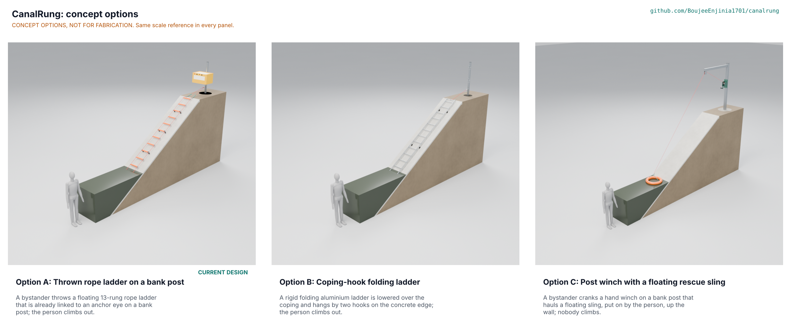

# CanalRung concept options

Option A, the thrown rope ladder on a bank post, scores 107 of a possible 145 against 92 for option C and 88 for option B, so it leads the runner-up by 14 percent, outside the 10 percent band; the recommendation is **Proposed, awaiting Amish** (CNR-DDR-004, CNR-DEC-001). Method: STANDARDS section 21. Option A is the current design and does not change. Options B and C are new, each with a different working principle, and each is modelled to the same D3 detail as A (`cad/src/model.py`, `cad/src/cnr_opts.py`, `cad/fidelity.json`).

> **Safety:** All three options are rescue-equipment concepts for research and education, never certified life-saving equipment. None has been built or tested. Never enter the water to rescue someone: throw, anchor and call the emergency number.

## The options

### Option A: thrown rope ladder on a bank post

Working principle: a floating 13-rung rope ladder, already linked to an eye nut on a bank post, is thrown by a bystander and lies down the wall; the person climbs out. A 60 x 60 x 3 mm galvanised post in a 500 x 1,200 mm footing carries a 70 L box with the folded ladder; 13 aluminium rungs with foam float sleeves hang on two 9 mm EN 1891 type B ropes through nylon bushes with knots and seizings; four HDPE stand-off blocks give hand room; a soft 0.5 kg weight leads the throw. The ladder as thrown weighs 4.27 kg and reaches the water on a 1.5:1 slope to 2.1 m and on a vertical wall to 3.8 m (CNR-CAL-001). Key risks: the thin rope margin (4.08 against 4), the cost (USD 605.20 against 500), and whether a cold person can climb a slick wall (trial at TRL 4). It needs a co-design partner to confirm banks, soil and heights.

### Option B: coping-hook folding ladder

Working principle: a rigid two-piece aluminium ladder is carried from two hangers on the bank post, lowered over the coping and left hanging on three rubber wall pads, with a 10 mm lanyard to the post's eye nut. Four RHS 25 x 45 x 2 mm stiles joined by two splice sleeves, 14 rungs of 25.4 x 3.2 mm tube bolted at 300 mm pitch, EPDM pads and end caps; a 350 x 900 mm footing and a 60 x 60 x 3 mm post 2,100 mm long. The ladder weighs 10.6 kg and is 4.2 m long. Key risks: handling a 10.6 kg, 4.2 m ladder over an edge (STEM S17), a rigid aluminium ladder lowered onto a person in the water, and a ladder that does not float so it must be set at the right depth. Its first design failed two STEM rows (S13, S16) and was fixed (CNR-DEC-001). It needs partner data on coping profiles.

### Option C: post winch with a floating rescue sling

Working principle: nobody climbs; a bystander cranks a hand winch on a bank post that hauls a floating collar sling, put on or held by the person, up the wall over a boom sheave. A 100 x 100 x 4 mm post 3,100 mm long in a 600 x 1,200 mm footing, a 1.5 m boom with a 100 mm sheave, a hand winch with a ratchet and pawl, an 8 mm rope and a float collar of 540 mm mean diameter (16 litres) with two straps. Key risks: the person must get into the sling in the water (a cold or exhausted person may not), an unattended exposed winch, the unknown 8 mm rope rating (STEM S22), a crank force of about 150 N for about 100 s (STEM S18), welding and ratchet cutting that a village workshop may not have. It needs a partner workshop with welding and a person able to crank.

Options already decided against: none was declined by Amish. The anchor and throw-line options of CNR-DDR-001 (D2 a to c, D7) were set aside under the 2026-10-03 pre-approval in favour of the post anchor and no throw line; B hangs from the post and the coping, not a ground stake, post loop or cross bar, and C hauls on a post-mounted rope rather than a thrown line, so neither re-proposes them.

## First-order numbers

*Table 1. Options compared. Part counts and model masses from `cad/fidelity.json` (D3); the model mass is dominated by the concrete footing.*

| Quantity | Option A | Option B | Option C |
| --- | --- | --- | --- |
| Estimated parts cost (USD) | 605.20 (BOM, indicative prices) | To assess; USD 101 of it is the post and footing scaled from BOM lines 1 and 2 (USD 48 post, USD 53 footing) | To assess; USD 209 of it is the footing scaled from BOM line 2 (post, winch, sling unpriced) |
| Carried or thrown mass (kg) | 4.27 (ladder as thrown) | 10.6 (ladder) | 0 carried; the sling and rope stay on the post |
| Model mass with footing (kg) | 579.4 | 224.4 | 854.1 |
| Output | Ladder 4,020 mm; reaches water 2.1 m down a 1.5:1 slope | Ladder about 4.2 m, rigid, fixed length | Sling hauled the full rope length, 4 m or more |
| Effort | One throw, about 15 s (estimate) | Lift and lower a 10.6 kg ladder | About 150 N crank force for about 100 s (estimate, S18) |
| Parts count (D3 model) | 178 (135 made or bought, 43 fasteners) | 92 (45 made or bought, 45 fasteners, 2 welds) | 46 (30 made or bought, 10 fasteners, 6 welds) |
| STEM check | 4 within, 9 plausible | 3 within, 2 plausible, 2 fixed | 3 within, 2 plausible |

## Scoring

*Table 2. Weighted scoring (weights: High UR 3, Medium 2, Low 1; scores 1 to 5; 145 is the maximum). Scores are the author's judgement from the models and CNR-CAL-001; they are not test results.*

| Criterion | Source | Weight | A | B | C | Reason |
| --- | --- | --- | --- | --- | --- | --- |
| Reach the person | UR-001 | 3 | 4 | 4 | 4 | All reach the 2.0 m design water; A and B by length, C by rope |
| Quick and obvious to use | UR-002 | 3 | 4 | 2 | 3 | A is a throw (15 s est.); B needs a lift and a lowering; C needs a release and cranking |
| Climb out unaided | UR-003 | 3 | 3 | 4 | 3 | B is rigid with pads; A is flexible on a slick wall; C needs a helper and the person in the sling |
| Carries an adult | UR-004 | 3 | 4 | 4 | 3 | A rung 0.56 of yield, ropes 4.08; B stiles 0.37 and rungs 0.52; C rope rating unknown |
| Stays attached | UR-005 | 3 | 4 | 3 | 4 | A anchor 1.53 to 3.58; B hangs on a lanyard and pads; C footing resists 13 times the boom moment |
| Harms no one | UR-006 | 3 | 4 | 2 | 3 | A soft weight; B a rigid ladder lowered over a person; C moving crank and a sling dragged on concrete |
| One adult can handle it | UR-007 | 2 | 4 | 2 | 4 | 4.27 kg against 10.6 kg; C carries nothing |
| Within reach at the surface | UR-008 | 2 | 4 | 2 | 5 | A floats (0.22 kg spare per rung); B does not float; C's collar lifts 16 kg |
| Lasts outdoors | UR-009 | 2 | 3 | 4 | 2 | A's rope sits in a box; B is aluminium and EPDM; C's winch and rope live outside |
| Cheap enough to place often | UR-010 | 2 | 2 | 3 | 2 | A is USD 105 over the target; B and C are unpriced; scored from stock used and part counts |
| Built and mended locally | UR-011 | 2 | 4 | 3 | 2 | A needs no welding; B has two welds; C has six welds and a cut ratchet |
| Inspected at a glance | UR-012 | 1 | 4 | 3 | 2 | A has a numbered tamper tag; C has exposed moving parts |
| **Weighted total** | | | **107** | **88** | **92** | A 74 percent of the maximum, C 63 percent, B 61 percent |

## Recommendation

Recommended: option A, **Proposed, awaiting Amish**. It leads option C by 15 points of 145 (14 percent of A's total), outside the 10 percent band, so no tie goes to Amish; the two lower options are not within 10 percent of A. A's weak scores are the climb on a slick wall (3), the cost (2) and the 4.08 rope margin, all of which stay open. Graft from the runners-up: from B, try EPDM wall pads in place of HDPE stand-off blocks for grip on wet concrete (TRL 4 idea, not designed); from C, the floating collar could replace the throw weight as a second grab point (not designed, not recommended without a rescue-practice reviewer). Nothing changes in the repository until Amish decides; option A stays the current design in `project.yaml` (`concept_chosen`).
